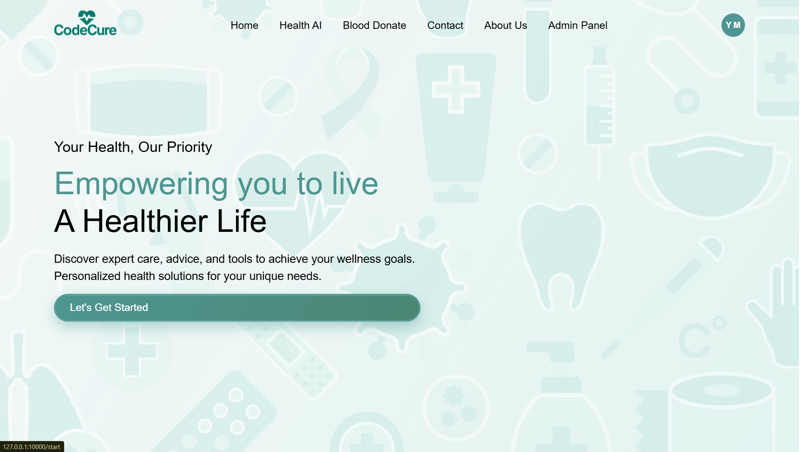
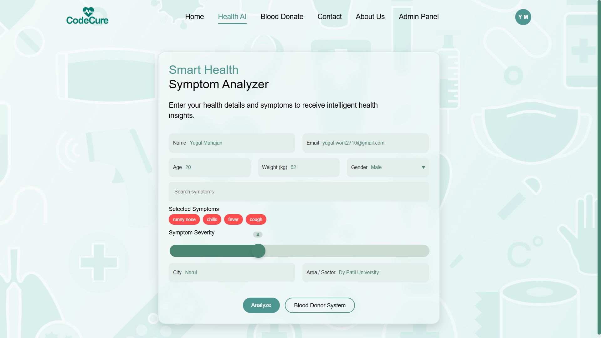
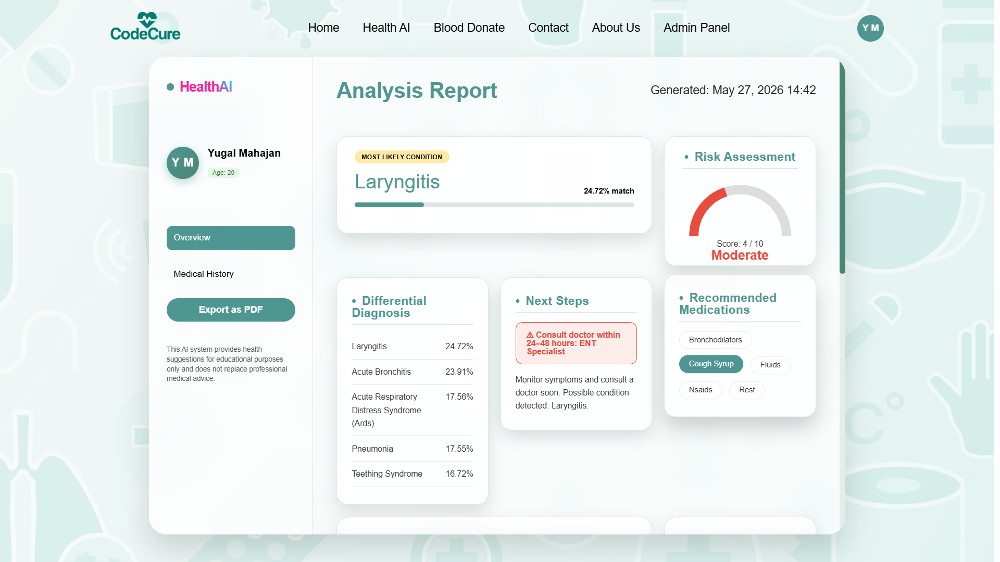
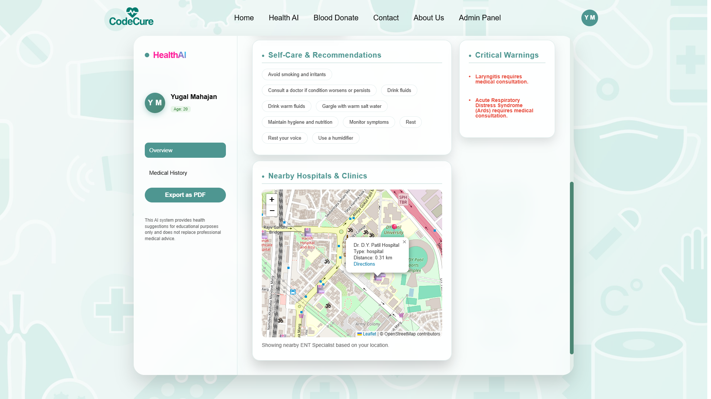
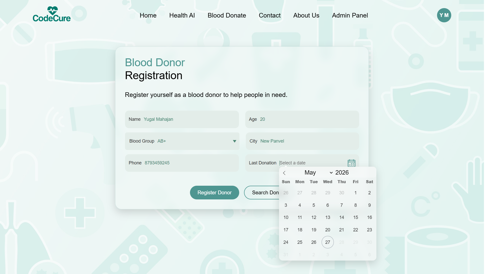
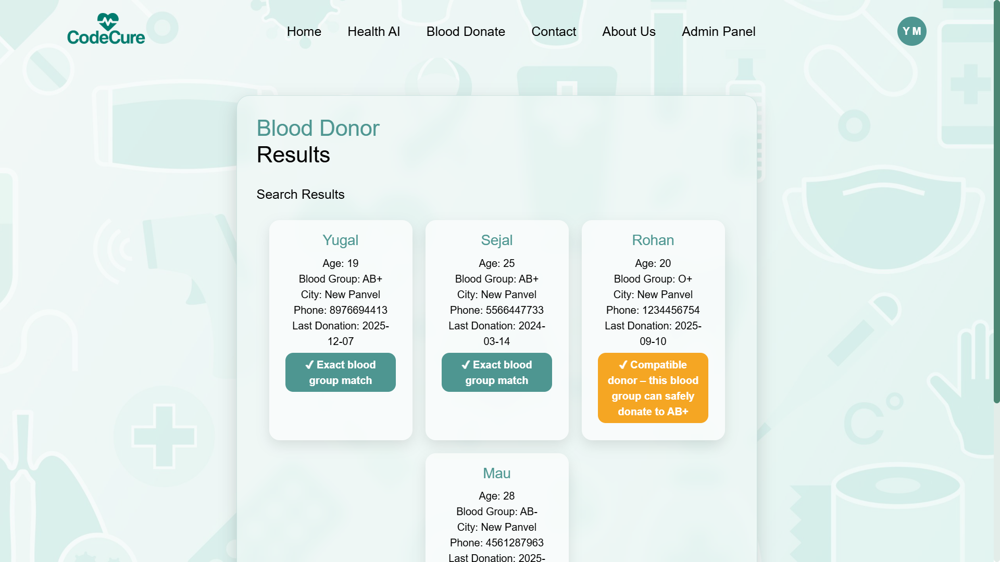
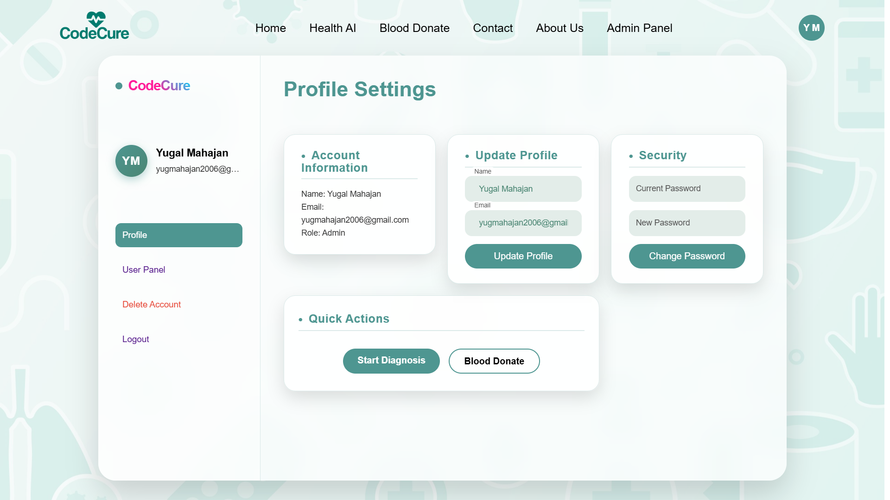
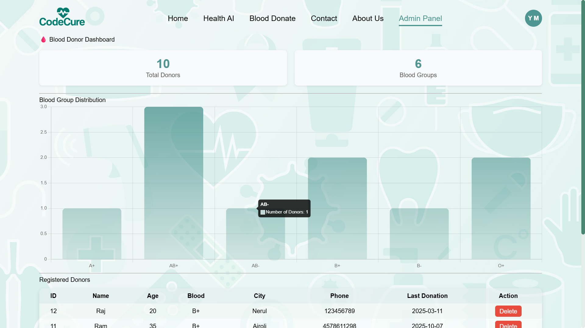
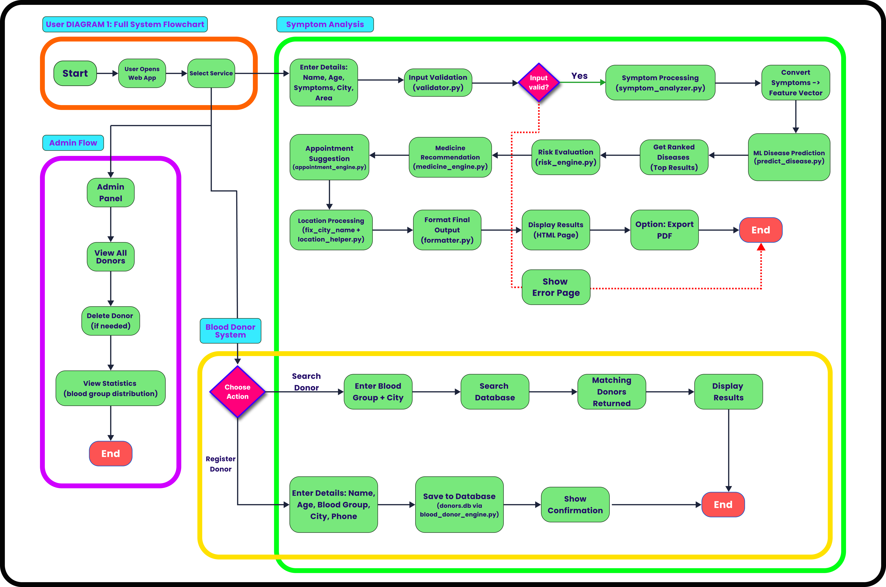
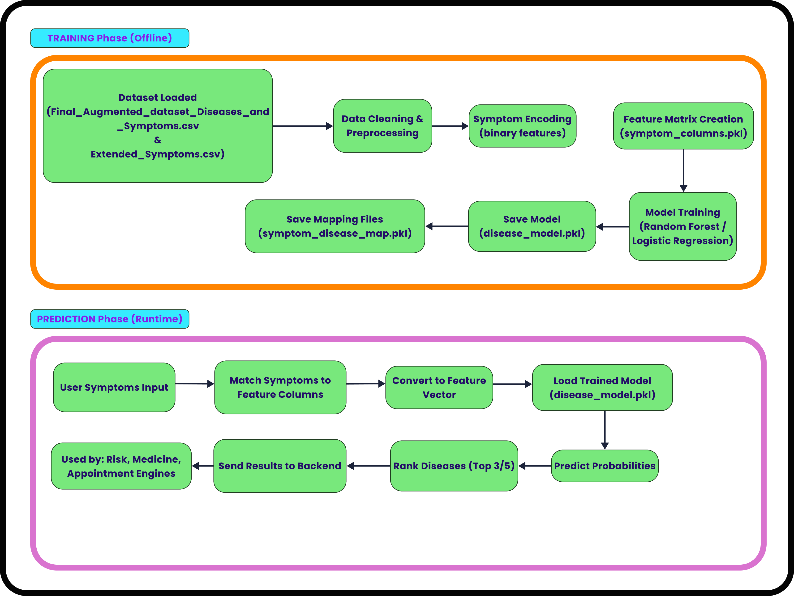

# Smart Health Advisor (CodeCure)

### AI-Powered Smart Health Advisor using Flask & Machine Learning

Smart Health Advisor (CodeCure) is an AI-powered healthcare assistance platform built using Python, Flask, and Machine Learning. It provides preliminary health insights based on user symptoms through disease prediction, probability-based classification, risk assessment, and personalized health recommendations.

The platform also integrates location-based healthcare services to help users discover nearby hospitals and clinics.

Additionally, it features a Blood Donor Management System that allows users to register as blood donors and search for compatible donors within their city.

> **Disclaimer:** This project is developed for educational and research purposes only. It does not replace professional medical advice, diagnosis, or treatment.

---

## Live Demo

**Deployed Application:**  
https://smart-health-advisor-qil4.onrender.com/

---

## Features

### AI-Based Symptom Analysis

- Symptom-based disease prediction using XGBoost.
- Probability-based disease ranking.
- Differential diagnosis generation.
- Symptom severity assessment.
- Risk level evaluation.

### Personalized Health Recommendations

- Self-care suggestions.
- Medication recommendations.
- Critical warning alerts.
- Doctor consultation guidance.

### Location-Based Healthcare Support

- Nearby hospital and clinic locator.
- Area-specific healthcare recommendations.
- Interactive map integration using Leaflet.js and OpenStreetMap.

### Blood Donor Management System

- Donor registration portal.
- Blood donor search by city.
- Blood group compatibility matching.
- Donor database management.

### User Management

- User registration and login.
- Profile management.
- Health report generation.
- PDF export functionality.

### Administrative Features

- User management dashboard.
- Blood donor management.
- Database monitoring.

---

## Machine Learning Pipeline

The disease prediction engine uses healthcare datasets collected from Kaggle and augmented symptom datasets.

The datasets are cleaned, merged, preprocessed, and divided into separate training and testing sets before training the XGBoost classification model.

### Data Processing Workflow

1. Load healthcare datasets.
2. Align symptom columns across datasets.
3. Merge datasets into a unified dataset.
4. Remove duplicate records.
5. Handle missing values.
6. Remove rare disease classes.
7. Create symptom-based feature vectors.
8. Split the dataset into training and testing sets.
9. Train the XGBoost classification model.
10. Evaluate model performance.
11. Save the trained model for deployment.

### Model Used: XGBoost Classifier

The project uses **XGBoost (Extreme Gradient Boosting)** for multi-class disease classification.

Model configuration:

```python
XGBClassifier(
    n_estimators=150,
    max_depth=6,
    learning_rate=0.1,
    subsample=0.8,
    colsample_bytree=0.8,
    objective="multi:softprob",
    random_state=42
)
```

### Model Configuration

| Parameter | Value |
|---|---|
| Algorithm | XGBoost |
| Number of Estimators | 150 |
| Maximum Depth | 6 |
| Learning Rate | 0.1 |
| Subsample | 0.8 |
| Column Sampling | 0.8 |
| Objective | multi:softprob |
| Random State | 42 |

### Dataset Preparation Statistics

The following statistics represent the dataset cleaning and preprocessing process.

| Parameter | Value |
|---|---:|
| Primary Dataset Records | 246,945 |
| Secondary Dataset Records | 26 |
| Total Merged Records | 246,971 |
| Duplicate Records Removed | 57,298 |
| Records After Primary Dataset Deduplication | 189,647 |
| Final Cleaned Dataset | 189,603 |
| Total Columns | 417 |
| Features | 416 |
| Disease Classes | 727 |
| Rare Disease Classes Removed | 70 |
| Rare-Class Records Removed | 70 |
| Missing Values Before Handling | 0 |
| Missing Values After Handling | 0 |

### Training and Testing Split

The cleaned dataset is divided into separate training and testing sets using a 70:30 split.

| Dataset | Samples | Percentage |
|---|---:|---:|
| Training Dataset | 132,722 | 70% |
| Testing Dataset | 56,881 | 30% |
| Total | 189,603 | 100% |

The training dataset is used to train the XGBoost model, while the testing dataset is used to evaluate its performance on unseen data.

### Model Performance

The XGBoost model achieved the following evaluation results on the held-out testing dataset.

**Overall Test Accuracy: 79.19%**

#### Evaluation Metrics

| Metric | Macro Average | Weighted Average |
|---|---:|---:|
| Precision | 55.67% | 79.20% |
| Recall | 54.87% | 79.19% |
| F1 Score | 54.85% | 79.07% |

#### Understanding the Metrics

- **Accuracy:** Percentage of correctly classified samples.
- **Precision:** Measures how many predicted disease classes were correct.
- **Recall:** Measures how many actual disease-class samples were correctly identified.
- **F1 Score:** Harmonic mean of precision and recall.
- **Macro Average:** Gives equal importance to every disease class.
- **Weighted Average:** Accounts for the number of samples in each disease class.

> **Important:** The 79.19% accuracy represents overall performance on the held-out test dataset. It should not be interpreted as the confidence or clinical reliability of an individual disease prediction.

---

## Prediction Process

### User Inputs

- Age
- Weight
- Gender
- Location
- Symptoms
- Symptom Severity

### System Outputs

- Most probable condition.
- Disease probability ranking.
- Risk assessment score.
- Self-care recommendations.
- Medication suggestions.
- Healthcare guidance.

---

## Project Screenshots

### Application Overview

<p align="center">
  
  
</p>

<p align="center">
  <em>Home Page</em> &nbsp;&nbsp;&nbsp;&nbsp;&nbsp;&nbsp;
  <em>Symptom Analysis Form</em>
</p>

---

### AI Analysis Reports

<p align="center">
  
  
</p>

<p align="center">
  <em>Disease Prediction Report</em> &nbsp;&nbsp;&nbsp;&nbsp;&nbsp;&nbsp;
  <em>Recommendations & Hospital Locator</em>
</p>

---

### Blood Donor Management System

<p align="center">
  
  
</p>

<p align="center">
  <em>Donor Registration</em> &nbsp;&nbsp;&nbsp;&nbsp;&nbsp;&nbsp;
  <em>Matching Donor Results</em>
</p>

---

### User & Administration

<p align="center">
  
  
</p>

<p align="center">
  <em>User Profile</em> &nbsp;&nbsp;&nbsp;&nbsp;&nbsp;&nbsp;
  <em>Admin Dashboard</em>
</p>

---

### System Architecture

<p align="center">
  
  
</p>

<p align="center">
  <em>System Flowchart</em> &nbsp;&nbsp;&nbsp;&nbsp;&nbsp;&nbsp;
  <em>Machine Learning Pipeline</em>
</p>

---

## Tech Stack

### Backend

- Python
- Flask
- SQLite

### Machine Learning

- XGBoost
- Scikit-Learn
- Pandas
- Joblib

### Frontend

- HTML5
- CSS3
- JavaScript

### Maps & Location Services

- OpenStreetMap
- Leaflet.js

### Deployment

- Render

---

## Backend Modules

| Module | Purpose |
|---|---|
| symptom_analyzer.py | Symptom processing |
| risk_engine.py | Risk evaluation |
| medicine_engine.py | Recommendation generation |
| clinical_rules.py | Healthcare rules engine |
| doctor_locator.py | Hospital discovery |
| blood_donor_engine.py | Donor matching |
| user_engine.py | User management |
| validator.py | Input validation |

---

## Datasets

The project uses healthcare datasets containing disease classifications and symptom mappings.

Primary datasets include:

- `Final_Augmented_dataset_Diseases_and_Symptoms.csv`
- `expanded_symptoms.csv`
- `Symptom-severity.csv`

These datasets are cleaned, aligned, and merged to create a unified dataset containing symptom-based features for multi-class disease classification.

---

## Installation

### Clone Repository

```bash
git clone https://github.com/Yugal006/smart-health-advisor.git

cd smart-health-advisor
```

### Create Virtual Environment

```bash
python -m venv venv
```

**Linux / macOS:**

```bash
source venv/bin/activate
```

**Windows:**

```bash
venv\Scripts\activate
```

### Install Dependencies

```bash
pip install -r requirements.txt
```

### Run Application

```bash
python app.py
```

Open your browser and navigate to:

```text
http://127.0.0.1:5000
```

---

## Future Enhancements

- Improved dataset coverage.
- Enhanced prediction performance.
- Integration with healthcare APIs.
- Appointment booking support.
- Medical report uploads.
- AI chatbot assistance.
- Mobile application version.

---

## Author

**Yugal Mahajan**

GitHub: https://github.com/Yugal006

---

## Disclaimer

Smart Health Advisor is an educational and research-oriented project. Its predictions and recommendations are generated using machine learning models and predefined rules. The application is not a substitute for professional medical diagnosis, treatment, or consultation.